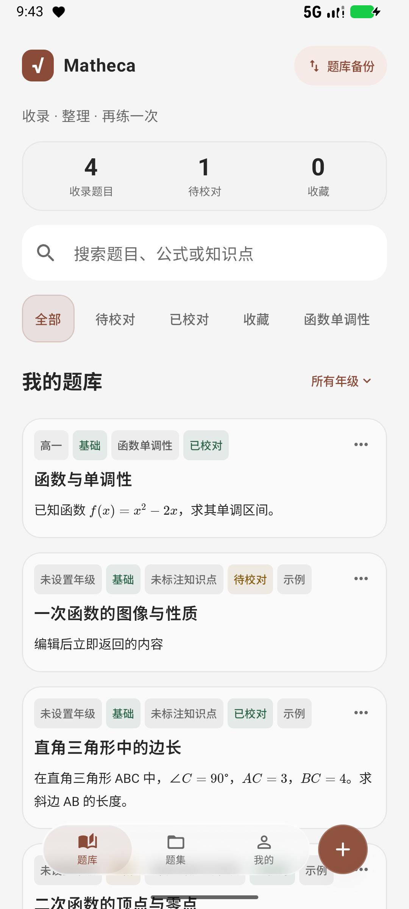
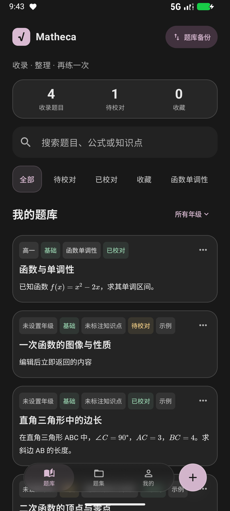

# 与桌面 Matheca 的配色对齐

2026-10-19，Android 0.22.0。

## 来源与范围

本次根据桌面 Matheca 的 `DESIGN.md`、`desktop/src/shared/color-themes.ts` 和 `desktop/src/renderer/workbench-theme.css` 提取实际配色。桌面默认石墨，另提供雾蓝、陶土、梅紫。Android 沿用相同名称、顺序和白天主色，不引入其他推荐色板。

桌面当前定义的是浅色工作台。Android 黑夜模式的中性底色和强调色为本次适配，不能视作已存在的桌面黑夜规范。已合入远端的同仓库整合，保留桌面源文件，项目统一名称为 Matheca。

## 白天颜色

| 语义 | 颜色 |
| --- | --- |
| 页面背景 | `#F5F5F5` |
| 面板 | `#FFFFFF` |
| 题目卡片 | `#FAFAFA` |
| 正文 | `#262626` |
| 辅助文字 | `#696969` |
| 分隔线 | `#E6E6E6` |
| 中性标签文字／底色 | `#565656` / `#EDEDED` |
| 已校对 | `#30664B` |
| 待校对／进阶 | `#886018` |
| 错误／挑战 | `#A23245` |

| 配色 | 主色 | 选中浅底 | 黑夜主色 | 黑夜选中底 |
| --- | --- | --- | --- | --- |
| 石墨（默认） | `#252525` | `#E8E8E8` | `#E2E2E2` | `#343434` |
| 雾蓝 | `#315A86` | `#E7EFF7` | `#AFCBE8` | `#293A4C` |
| 陶土 | `#8A4C38` | `#F5EAE5` | `#EABBA9` | `#48342D` |
| 梅紫 | `#74516D` | `#F1EAF0` | `#D9BAD2` | `#41323E` |

黑夜页面 `#181818`、面板 `#222222`、题目卡片 `#242424`、正文 `#E8E8E8`、辅助文字 `#B3B3B3`。主要按钮使用浅强调色配深色文字，避免浅色按钮上的白字失去对比。

## 应用规则

- “我的 → 外观”中独立选择明暗模式与配色，两个选项均本地持久化。原来没有配色偏好的安装默认使用石墨，不修改原有明暗设置、接口或题库。
- 阅读背景和重复出现的年级、知识点标签保持中性。主操作、导航选中、筛选与焦点跟随强调色；校对、警告、错误颜色与强调色独立，并保留文字标签。
- 顶部统计取消亮蓝渐变，使用中性底色，数字和中文继续等宽、紧凑、居中。
- 公式正文与独立公式预览使用中性文字，题干与 AI 解答保持相同颜色。公式错误使用对应明暗模式的错误色。文档输出仍采用浅色纸张。
- 菜单保留圆角和无黑色阴影边框，白天为 `#EEEEEE`、黑夜为 `#383838`，与页面和卡片区分。白天底色使用桌面的 hover 灰，保证 `#696969` 辅助文字的对比度。
- 悬浮按钮保留轻微透明、模糊及回弹，底色与文字使用主题的 primary / onPrimary 配对。现有导航高度、固定顶部及选题关闭动效保留。
- 题库 ZIP 的格式版本仍为 1；配色与其他应用外观偏好一样，不进入题库备份。数据库版本保持 4。

## 实现与验证入口

- [主题颜色](../app/src/main/java/com/mathector/app/ui/MathecaTheme.kt)：统一 Material 3 角色和标签、菜单、状态色。
- [外观设置](../app/src/main/java/com/mathector/app/ui/AppearanceSettings.kt)：48 dp 选择区域、单选语义和可换行的明暗选项。
- [配色测试](../app/src/test/java/com/mathector/app/MathecaPaletteTest.kt)：桌面颜色契约、八种组合的文字对比与输入边界。
- [设备测试](../app/src/androidTest/java/com/mathector/app/MathecaAppearanceTest.kt)：本地持久化、设置切换、统计文字、菜单与选题关闭、横屏可达性。

UI/UX Pro Max 的 Jetpack Compose 检索匹配到 Theming / Dark mode support 和 Theming / Design system：采用 `colorScheme`、集中主题，消除组件内固定强调色。配色来源始终是上述桌面实现；未使用生成色板替代桌面设计。

## 其他配色预览

| 陶土 · 白天 | 梅紫 · 黑夜 |
| --- | --- |
|  |  |
